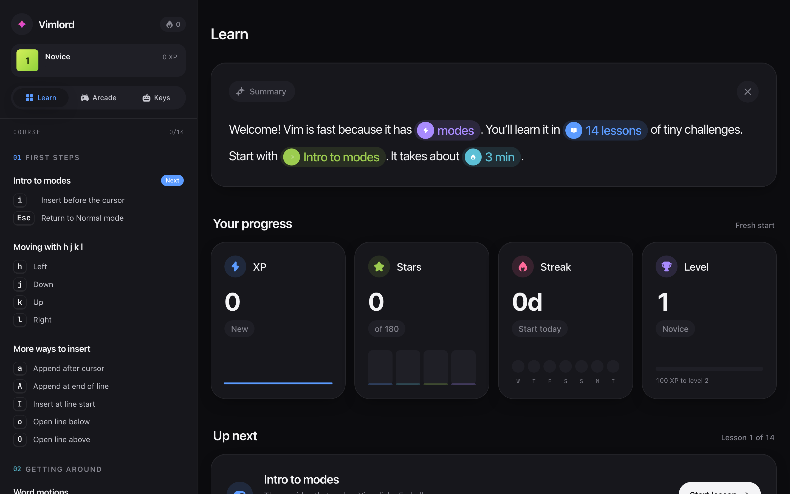
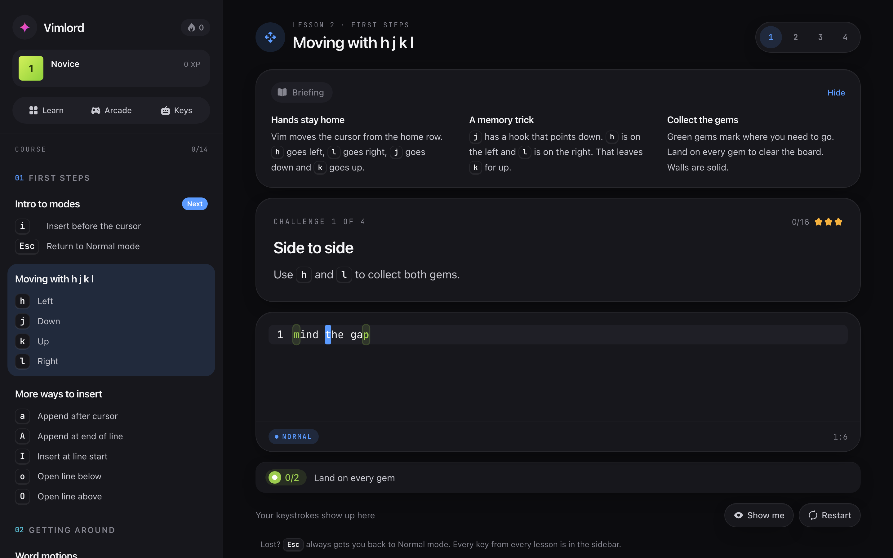
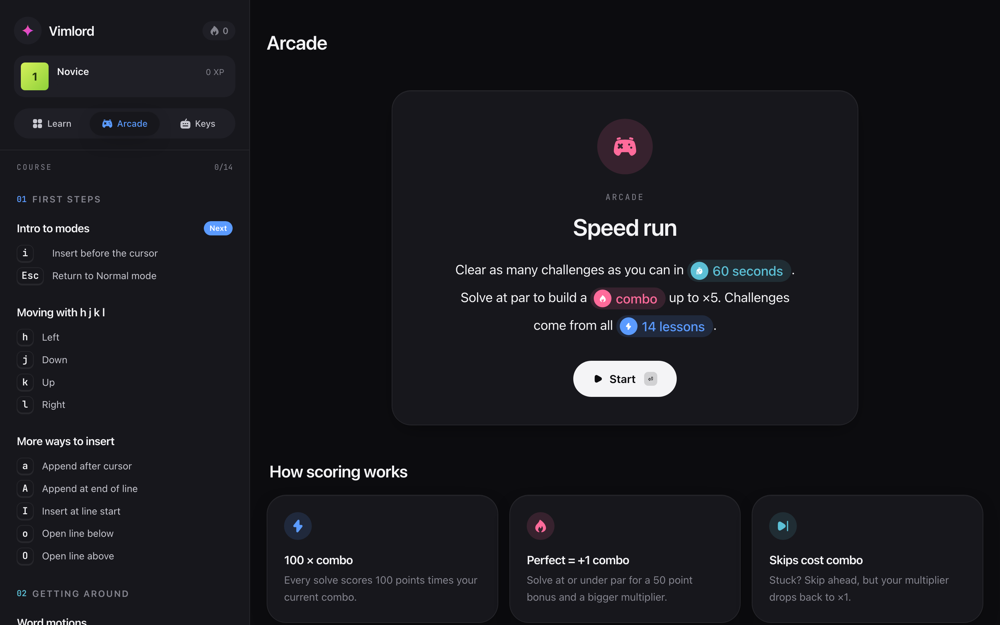
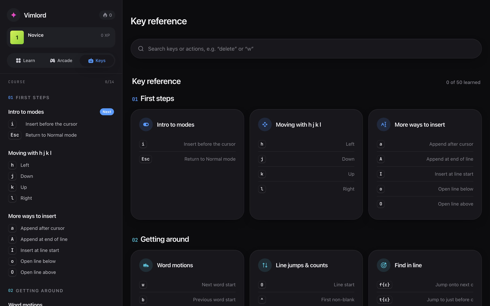

<div align="center">

# ✦ Vimlord

**Learn Vim by playing.** Short game-style lessons that teach Vim one key at a time, all inside a Vim emulator that runs in your browser.

[**Play it → vim.dhruvdeora.com**](https://vim.dhruvdeora.com)




</div>

## What it is

Vimlord turns Vim's learning curve into a series of small puzzles. Each lesson opens with a short briefing, then gives you a handful of challenges in a real modal editor: reach the gems, fix the text, or switch to the right mode. Solve it in as few keystrokes as the reference solution and you earn three stars.

- **14 lessons, 60 challenges** across four chapters: *First steps*, *Getting around*, *Making changes* and *Power moves*
- **A Vim engine written from scratch**: Normal, Insert, Visual, Visual-line and search modes, operators with motions, text objects, counts, registers, undo/redo and `.` repeat
- **Par and stars**: every challenge has a par (the length of the reference solution). Three stars at or under par, two within 50% over it, one otherwise
- **Arcade mode**: a 60-second speed run of random challenges, with a combo multiplier up to ×5
- **Progress tracking**: XP, levels, a daily streak and a weekly activity chart, saved in `localStorage`
- **Key reference**: every key from every lesson, searchable, marking the ones you've learned

## Screenshots

| Lesson | Arcade |
| :---: | :---: |
|  |  |
| **Key reference** | **Dashboard** |
|  |  |

## Tech stack

| Layer | Tools |
| --- | --- |
| Framework | [TanStack Start](https://tanstack.com/start) with [TanStack Router](https://tanstack.com/router) (file-based routes, SSR) |
| UI | [React 19](https://react.dev) |
| Language | [TypeScript](https://www.typescriptlang.org) |
| Styling | [Tailwind CSS v4](https://tailwindcss.com) via `@tailwindcss/vite` |
| Build | [Vite 8](https://vite.dev) |
| Server / deploy | [Nitro](https://nitro.build) output, hosted on [Vercel](https://vercel.com) |
| Fonts & icons | Inter, JetBrains Mono, [Hugeicons](https://hugeicons.com) (inlined SVG) |
| Package manager | [pnpm](https://pnpm.io) |

The Vim emulator has no dependencies: [`src/lib/vim/engine.ts`](src/lib/vim/engine.ts) keeps the buffer as one string with a cursor offset, and every keypress goes through a pure `feed(state, key)` function that returns the next state.

## Getting started

You need Node.js 22 or newer and pnpm.

```bash
pnpm install
```

```bash
pnpm dev
```

The dev server runs at http://localhost:3100.

### Scripts

| Command | What it does |
| --- | --- |
| `pnpm dev` | Start the dev server on port 3100 |
| `pnpm build` | Production build |
| `pnpm start` | Preview the production build |
| `pnpm typecheck` | Run `tsc --noEmit` |
| `pnpm check:lessons` | Replay every challenge's reference solution through the engine and check that it solves the challenge on its last key |
| `pnpm gen:icons` | Regenerate `src/components/icons.tsx` from a local Hugeicons checkout |

## Project structure

```
src/
├── routes/
│   ├── index.tsx              # Dashboard: course overview and progress
│   ├── lesson.$lessonId.tsx   # Lesson: briefing and challenges
│   ├── arcade.tsx             # 60-second speed run
│   └── keys.tsx               # Searchable key reference
├── components/
│   ├── VimEditor.tsx          # Editor view on top of the engine
│   ├── ChallengeRunner.tsx    # Runs a challenge and scores it
│   ├── Chrome.tsx             # Sidebar, header, navigation
│   └── ui.tsx                 # Shared UI pieces (chips, stars, charts)
└── lib/
    ├── vim/engine.ts          # The Vim emulator
    ├── lessons.ts             # All chapters, lessons and challenges
    ├── challenge.ts           # Goal checking, par and star scoring
    └── progress.ts            # XP, streaks and saved progress
```

## Adding a challenge

Lessons and challenges live in [`src/lib/lessons.ts`](src/lib/lessons.ts). In a challenge's `start` buffer, put `▮` before the character the cursor starts on and `◆` before each character the player has to reach. In prompts, `{key}` renders a key chip and `**text**` adds emphasis.

```ts
{
  title: 'Side to side',
  prompt: 'Use {h} and {l} to collect both gems.',
  start: '◆mind ▮the ga◆p',
  goal: 'reach',
  solution: 'hhhhhlllllllllll',
  allowed: ['h', 'l'],
}
```

Run `pnpm check:lessons` afterwards to confirm the reference solution works.
